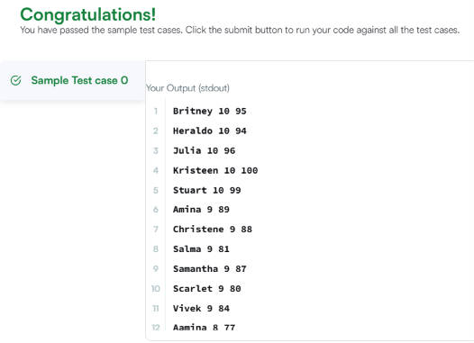

# Soal 1: The Report
### Jawaban:

```sql
SELECT 
    case when g.Grade >= 8 then s.Name else "NULL" end as Name,
    g.Grade,
    s.Marks
FROM Students s
LEFT JOIN Grades g ON s.Marks BETWEEN g.Min_Mark AND g.Max_Mark
order by g.Grade Desc, s.Name;
```

###Output:

