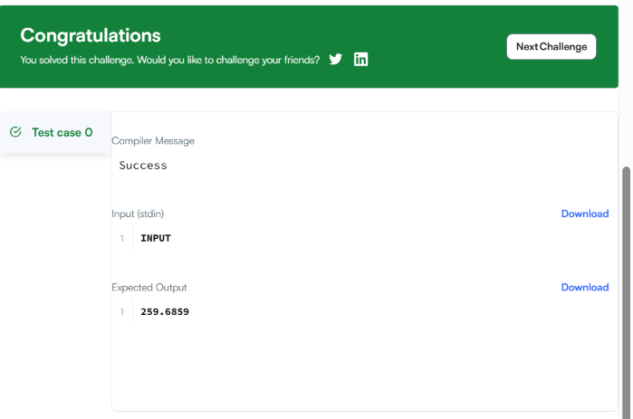
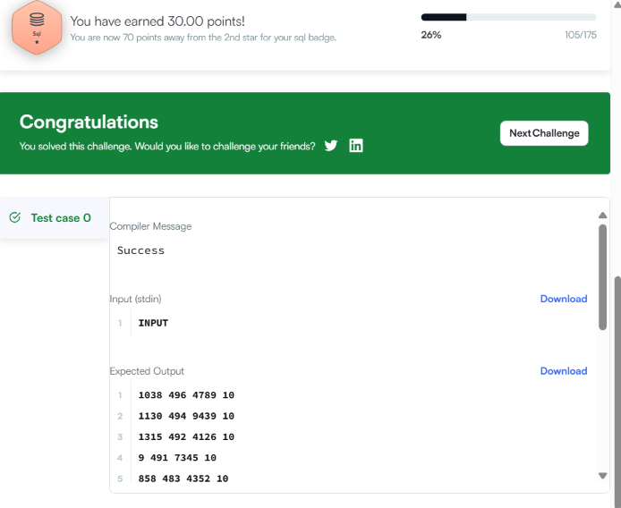
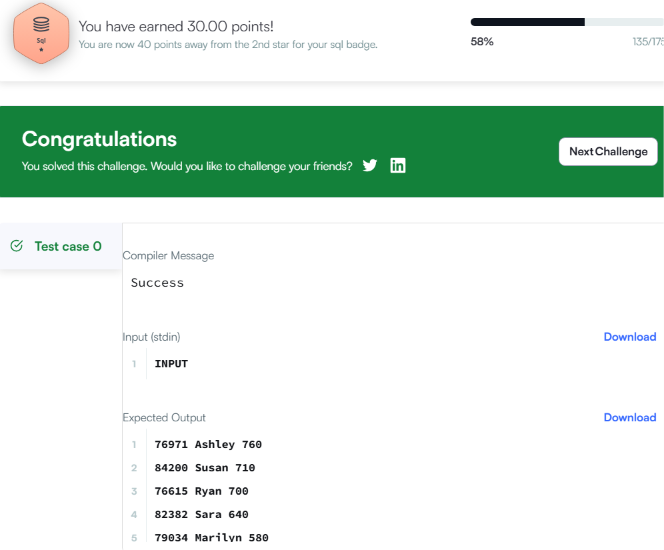

# Soal 1: The Report
### Jawaban versi 1 (MySQL):
```sql
SELECT 
    case when g.Grade >= 8 then s.Name else "NULL" end as Name,
    g.Grade,
    s.Marks
FROM Students s
LEFT JOIN Grades g ON s.Marks BETWEEN g.Min_Mark AND g.Max_Mark
order by g.Grade Desc, s.Name;
```
### Jawaban versi 2 (MS SQL):
```sql
SET NOCOUNT ON;

WITH cte_student_grade AS (
    SELECT
        s.Name AS Name,
        g.Grade AS Grade,
        s.Marks AS Marks
    FROM Students s
    LEFT JOIN Grades g
        ON s.Marks BETWEEN g.Min_Mark AND g.Max_Mark
)
SELECT
    CASE
        WHEN csg.Grade >= 8 THEN csg.Name
        ELSE 'NULL'
    END AS Name,
    csg.Grade,
    csg.Marks
FROM cte_student_grade csg
ORDER BY
    csg.Grade DESC,
    CASE WHEN csg.Grade >= 8 THEN csg.Name END ASC,
    CASE WHEN csg.Grade < 8 THEN csg.Marks END ASC;

go
```
###Output:


# Soal 2: Weather Observation Station 18
### Jawaban (MS SQL):

```sql
SET NOCOUNT ON;

with cte_min_max as (
    select
    min(LAT_N) min_lat,
    max(LAT_N) max_lat,
    min(LONG_W) min_long,
    max(LONG_W) max_long
    from STATION
)
select 
    cast(round(abs(min_lat - max_lat) + abs(min_long - max_long),4) 
    as decimal(10,4))
from cte_min_max;

go
```
###Output:



# Soal 3: Top Competitors
### Jawaban (MS SQL):

```sql
SET NOCOUNT ON;

--tentukan max_score_criteria per challenge
WITH cte_max_criteria AS (
    SELECT c.challenge_id, d.score AS max_criteria
    FROM Challenges c
    INNER JOIN Difficulty d ON c.difficulty_level = d.difficulty_level
),
--ambil mereka yg took challenge >1(jumlah_challenge_diikuti harus >1) dan scorenya reach max_criteria
--untuk hindari efek tie, pakai distinct
cte_score_submitted AS (   
  SELECT    
    COUNT(DISTINCT s.challenge_id) jumlah_challenge_diikuti , hacker_id
    FROM Submissions s
    INNER JOIN cte_max_criteria cmc on cmc.challenge_id = s.challenge_id
    where s.score = cmc.max_criteria 
    group by hacker_id
    having count(hacker_id) > 1
),
--dapatkan identitas para peserta
cte_person_name AS (
    SELECT css.hacker_id, h.name
    FROM Hackers h
    INNER JOIN cte_score_submitted css on h.hacker_id = css.hacker_id
)
SELECT 
    cpn.hacker_id, cpn.name
FROM cte_person_name cpn
INNER JOIN cte_score_submitted css on cpn.hacker_id = css.hacker_id
ORDER BY css.jumlah_challenge_diikuti Desc, cpn.hacker_id

go
```
###Output:


# Soal 4: Ollivander's Inventory
### Jawaban (MS SQL):

```sql
SET NOCOUNT ON;

--cek apakah ada age dan power sama tapi harga berbeda (ternyata ada)
--di soal si hermoine ingin ambil wands tapi harga paling minimum, 
--maka pakai window tapi pakai partisi karena tiap item berbeda
with cte_coin_minimum as (
    select w.id, wp.age, w.power, w.coins_needed, min(coins_needed) over(partition by wp.age, w.power) min_coin
    from Wands w
    inner join Wands_Property wp on w.code = wp.code
    where wp.is_evil != 1
)
--di sini baru kita filter hanya yg sesuai dengan min_coin tersebut
select w.id, ccm.age, w.coins_needed, w.power
from Wands w
inner join cte_coin_minimum ccm on w.id = ccm.id
where w.coins_needed = ccm.min_coin
order by w.power Desc, age DESC 

go
```
###Output:



# Soal 5: Contest Leaderboard
### Jawaban (MS SQL):

```sql
SET NOCOUNT ON;

--peserta berulang kali mengambil tes yg sama, langsung ambil id yg max score-nya
with cte_max_id as (
select challenge_id, hacker_id, max(score) max_score
from Submissions
where score > 1 
group by challenge_id, hacker_id
)
--kita saring nilai tertingginya agar ini bisa dijumlahkan menjadi total score
select cmi.hacker_id, h.name, sum(cmi.max_score) total_score
from cte_max_id cmi
inner join Hackers h on cmi.hacker_id = h.hacker_id
group by cmi.hacker_id, h.name
order by sum(cmi.max_score) desc, cmi.hacker_id

go
```

###Output:
